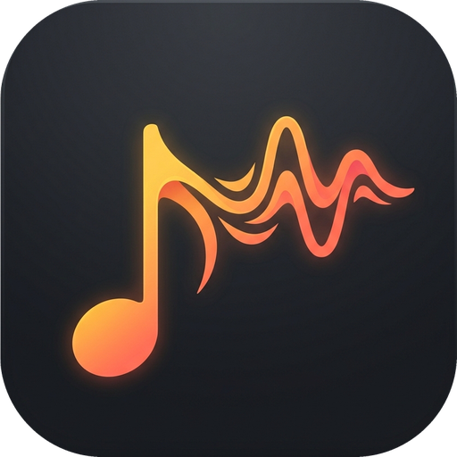
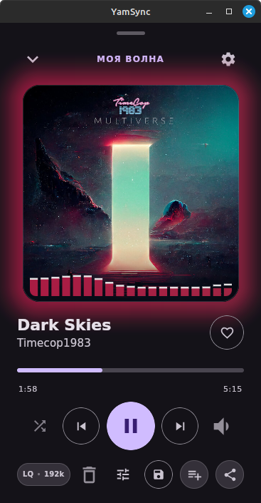
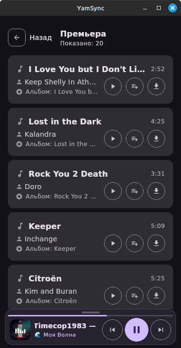
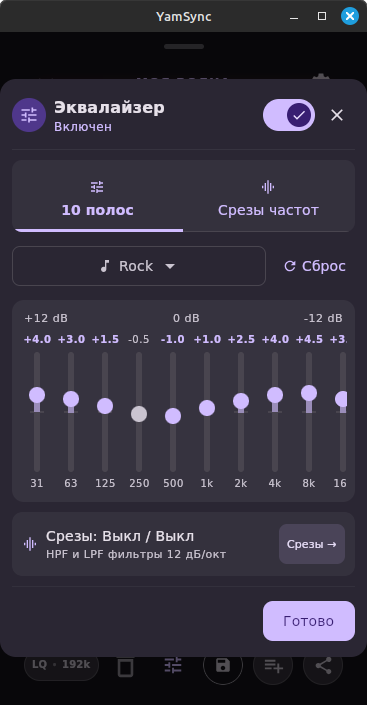
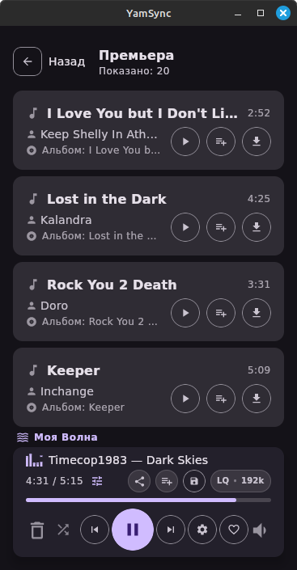
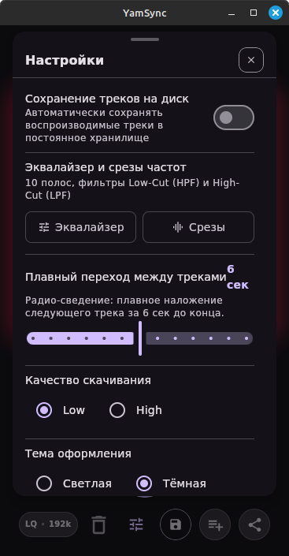

<p align="center">
  
</p>

<h1 align="center">YamSync</h1>

<p align="center">
  <b>Автономный кроссплатформенный аудиоплеер, менеджер локальной медиатеки и загрузчик для Яндекс Музыки (Offline-First)</b><br>
  Создан на базе <b>Kotlin Multiplatform (KMP)</b> и <b>Compose Multiplatform</b> для Desktop (Linux, Windows, macOS), iOS и Android.
</p>

<p align="center">
  
  
  
  
  
  
  <a href="https://t.me/+5PT1eAkb7CxjYzNi">
    
  </a>
  <a href="LICENSE">
    
  </a>
</p>

---

## 📸 Скриншоты

<p align="center">
  <table align="center" style="border: none; border-collapse: collapse; margin: 0 auto;">
    <tr align="center" valign="top">
      <td align="center" style="border: none; padding: 6px;">
        <br>
        <sub><b>🌊 Моя Волна и Плеер</b></sub>
      </td>
      <td align="center" style="border: none; padding: 6px;">
        <br>
        <sub><b>📜 Плейлисты и Поиск</b></sub>
      </td>
      <td align="center" style="border: none; padding: 6px;">
        <br>
        <sub><b>🎚️ 10-полосный EQ и Срезы</b></sub>
      </td>
      <td align="center" style="border: none; padding: 6px;">
        <br>
        <sub><b>🖥️ Десктоп / Winamp вид</b></sub>
      </td>
      <td align="center" style="border: none; padding: 6px;">
        <br>
        <sub><b>⚙️ Настройки и Синхронизация</b></sub>
      </td>
    </tr>
  </table>
</p>

---

## 📥 Скачать (Готовые сборки)

Готовые установочные пакеты доступны на странице **[GitHub Releases](https://github.com/audiz/YamSync/releases/latest)**:

| Платформа | Формат | Описание | Ссылка на загрузку |
| :--- | :--- | :--- | :--- |
| 🤖 **Android** | `.apk` | Смартфоны и планшеты (Android 8.0+) | [Скачать APK](https://github.com/audiz/YamSync/releases/latest) |
| 🪟 **Windows** | `.msi` / `.exe` | Windows 10 / 11 (x64) | [Скачать для Windows](https://github.com/audiz/YamSync/releases/latest) |
| 🐧 **Linux** | `.deb` / `.rpm` | Ubuntu, Debian, Fedora, Arch и др. | [Скачать для Linux](https://github.com/audiz/YamSync/releases/latest) |
| 🍏 **macOS** | `.dmg` | macOS 12+ (Apple Silicon и Intel) | [Скачать DMG](https://github.com/audiz/YamSync/releases/latest) |
| 📱 **iOS** | `.ipa` | iPhone & iPad (iOS 15+) | [Скачать IPA](https://github.com/audiz/YamSync/releases/latest) |

> [!NOTE]
> **Установка на iOS (Sideloading):**  
> Файл `.ipa` устанавливается без джейлбрейка через **AltStore**, **SideStore**, **Sideloadly**, **TrollStore** или **Scarlet**.

---

## ✨ Ключевые возможности

### 💾 1. Автономность и локальное хранилище (Offline-First)
YamSync спроектирован по принципу **Offline-First**: приложение является полноценной автономной музыкальной станцией, независимой от постоянного подключения к интернету и серверам Яндекс Музыки.
- **Полная работа без доступа к сети:** вся сохранённая музыка, персональные плейлисты, метаданные и обложки альбомов доступны автономно в авиарежиме, в путешествиях или при сбоях связи.
- **Локальные оффлайн-плейлисты:**
  - Создание, редактирование, переименование и организация собственных локальных плейлистов прямо на диске без обязательной привязки к аккаунту.
  - Хранение структуры плейлистов в независимом JSON-формате во внутреннем каталоге приложения.
- **Экспорт в M3U8:** выгрузка любого локального плейлиста в стандартный файл `.m3u8` (с относительными или абсолютными путями к трекам) для воспроизведения в любых сторонних аудиоплеерах или автомагнитолах.
- **Поддержка собственных аудиофайлов:** быстрое добавление локальных папок с музыкой, отдельных файлов (`.mp3`, `.flac`, `.m4a`) и внешних плейлистов.
- **Вшивание полных метаданных:** автоматическое сохранение ID3v2/MP4 тегов (исполнители, названия, альбомы, года, жанры) и обложек альбомов максимального разрешения при записи на диск.
- **Нативный выбор папок хранения (включая SD-карты):**
  - На Android: интеграция со **Storage Access Framework (SAF)** (`Intent.ACTION_OPEN_DOCUMENT_TREE`) — выбор любой папки на встроенном накопителе или внешней SD-карте с автоматическим сохранением постоянных прав доступа (`takePersistableUriPermission`).
  - На Desktop и iOS: нативные диалоги выбора файлов и папок.
  - Кнопка **«📁 Обзор...»** прямо в диалоге настроек («Папка загрузки») и окне добавления музыки.

---

### 🔄 2. Двусторонняя синхронизация плейлистов с Яндекс Музыкой
Приложение обеспечивает гибкую связку между вашей локальной медиатекой и облачным каталогом Яндекс Музыки:
- **Скачивание плейлистов в один клик:** возможность перенести любой облачный плейлист из вашего аккаунта («Плейлист дня», «Дежавю», «Премьера», пользовательские подборки) в независимый локальный оффлайн-плейлист с пакетной загрузкой всех треков на устройство.
- **Автосохранение при добавлении в локальный плейлист:** добавление любого онлайн-трека в локальный плейлист автоматически загружает и кэширует его аудиофайл на диск.
- **Умный экспорт локальных треков в облако Яндекса:** при добавлении трека из локальной медиатеки в облачный плейлист аккаунта приложение на лету находит точное соответствие в каталоге Яндекс Музыки по тегам исполнителя и названия, привязывая трек к вашему профилю.
- **Двусторонний учёт лайков и дизлайков:** оптимистичное мгновенное переключение отметок «Мне нравится» в UI с фоновой синхронизацией с сервером при наличии сети.

---

### ⚡ 3. Локальная P2P-синхронизация фонотеки (YamSync P2P Engine)
Встроенный протокол прямой синхронизации медиатеки между устройствами без облачных серверов, проводов и ограничений скорости:
- **Прямой обмен по Wi-Fi / LAN:** передача аудиофайлов и локальных плейлистов напрямую между компьютером (Windows, macOS, Linux) и смартфонами (Android, iOS) внутри домашней сети.
- **Мгновенное сопряжение:** подключение через сканирование **QR-кода** камерой смартфона или автообнаружение устройств в локальной сети (mDNS/UDP).
- **Сравнение фонотек (Diff Engine):** наглядный двусторонний анализ медиатек двух устройств:
  - 🟢 Общие треки, уже присутствующие на обоих устройствах.
  - 🔵 Треки, имеющиеся только локально.
  - 🟣 Треки, имеющиеся только на удалённом устройстве.
- **Безопасное умное слияние (Merge):** синхронизация недостающих файлов с контролем контрольных сумм SHA-256, защитой от перезаписи и созданием резервных копий.
- **Статус-виджет (`YamSyncPill`):** компактный индикатор подключения и статуса синхронизации прямо в главном окне плеера.

---

### 🎧 4. Продвинутый аудиоплеер и «Моя Волна»
- **Мгновенный потоковый запуск (Zero-Latency Chunked Streaming):** воспроизведение начинается за 100–200 мс без ожидания полной загрузки файла (на Desktop — локальный кольцевой буфер, на iOS — нативный `AVAssetResourceLoaderDelegate`).
- **Базовая персональная волна без подписки:** прослушивание бесконечного персонализированного потока «Моя Волна» доступно даже без активной подписки Яндекс Плюс и без авторизации (гостевой режим).
- **Алгоритм True Shuffle (Честное перемешивание):** режим циклического воспроизведения гарантирует, что каждый трек из плейлиста сыграет ровно один раз за цикл без случайных повторов одних и тех же композиций. При завершении круга запускается новый раунд со свежей тасовкой.
- **Плавная навигация и история:** полнофункциональная история переходов назад/вперед (⏮ / ⏭), предзагрузка следующего трека и защищённая очередь воспроизведения.

---

### 🎚️ 5. Профессиональный DSP-эквалайзер и фильтры
- **10-полосный графический эквалайзер:** амплитуда от -12 дБ до +12 дБ для частот 31 Гц, 63 Гц, 125 Гц, 250 Гц, 500 Гц, 1 кГц, 2 кГц, 4 кГц, 8 кГц, 16 кГц.
- **Фильтры среза частот (Cut Filters):**
  - **Low-Cut (HPF):** отсечение нежелательного суб-басового гула и разгрузка динамиков.
  - **High-Cut (LPF):** устранение высокочастотного шипения и чрезмерной резкости.
  - Крутизна спада фильтров: 12 дБ/октава.
- **Пресеты звучания:** готовые конфигурации (Rock, Pop, Bass Boost, Vocal, Flat и др.) с возможностью ручной подстройки (Custom) и мгновенным сбросом.

---

### 🖥️ 6. Системная интеграция и мультиплатформа
- **Аппаратные клавиши и медиавиджеты ОС:**
  - Linux MPRIS (управление с панели задач, клавиатуры и локскрина).
  - Windows SMTC (системный оверлей громкости и управления воспроизведением).
  - iOS Now Playing Info Center и Remote Command Center (управление с экрана блокировки и Dynamic Island).
  - Android MediaSession (полнофункциональное уведомление и экран блокировки).
- **Deep Links (`yamsync://`):** запуск воспроизведения треков по ссылкам формата `yamsync://track/<id>` из мессенджеров, заметок и браузера.
- **Material Design 3:** адаптивный интерфейс для планшетов, мобильных и настольных экранов с поддержкой Светлой и Тёмной тем.

---

## 🔑 Авторизация (Подключение аккаунта)

Для загрузки треков в высоком качестве, доступа к персональной медиатеке и облачным плейлистам требуется авторизация с аккаунтом Яндекс Плюс.

### Способ 1: Быстрая авторизация через браузер (Рекомендуемый)
1. Откройте **Настройки** (иконка шестерёнки в приложении).
2. В разделе **«Авторизация в Яндекс Музыке (OAuth)»** нажмите кнопку **«🌐 1. Получить токен в браузере»**.
3. В открывшемся окне браузера войдите в свой аккаунт Яндекс и подтвердите доступ.
4. После перенаправления скопируйте всю ссылку из адресной строки браузера (содержит `#access_token=AQAAAA...`) или только сам токен.
5. Вставьте ссылку или токен в поле ввода приложения и нажмите **«💾 2. Сохранить токен»**.

### Способ 2: Прямая ссылка на получение OAuth-токена
```text
https://oauth.yandex.ru/authorize?response_type=token&client_id=23cabb9da7144e6792942475a3b68078
```
После подтверждения скопируйте `access_token` из адресной строки и сохраните в настройках YamSync.

---

## ⌨️ Мультимедиа-контроль и интеграция с ОС

YamSync нативно интегрирован в мультимедийные интерфейсы всех поддерживаемых платформ:
- **Аппаратные клавиши управления:** клавиши `Play/Pause`, `Next`, `Previous`, `Mute` на клавиатурах, гарнитурах и Bluetooth-наушниках работают из коробки.
- **Linux:** интеграция по стандарту **MPRIS2** (системный трей, апплеты панелей GNOME / KDE и экран блокировки).
- **Windows:** системный медиаоверлей **SMTC** (System Media Transport Controls) с обложкой трека и кнопками навигации.
- **iOS:** нативный **Now Playing Info Center** и **Remote Command Center** (управление с экрана блокировки, Dynamic Island и Apple Watch).
- **Android:** уведомление медиасессии с кнопками управления и виджетом на экране блокировки.

---

## ❓ Часто задаваемые вопросы (FAQ)

<details>
<summary><b>✈️ Может ли приложение работать полностью без интернета и серверов Яндекса?</b></summary>
<p>
Да! YamSync спроектирован по принципу <b>Offline-First</b>. Все скачанные треки, созданные локальные плейлисты, добавленные пользовательские папки и плейлисты M3U воспроизводятся полностью автономно без обращения к сети. Приложение не требует обязательного подключения к серверам Яндекса для прослушивания локальной библиотеки.
</p>
</details>

<details>
<summary><b>🔄 Как устроена синхронизация локальных плейлистов с Яндекс Музыкой?</b></summary>
<p>
Синхронизация работает в двух направлениях:
1. <b>Из Яндекса в локальное хранилище:</b> в диалоге плейлистов можно в один клик скачать любой облачный плейлист — приложение создаст независимый локальный плейлист и загрузит все его аудиофайлы на ваше устройство.
2. <b>Из локального хранилища в Яндекс:</b> при добавлении локального трека в облачный плейлист вашего аккаунта YamSync автоматически сопоставляет локальный файл с каталогом Яндекс Музыки по тегам исполнителя и названия.
</p>
</details>

<details>
<summary><b>⚡ Как передавать музыку между ПК и смартфоном без интернета и проводов?</b></summary>
<p>
Используйте встроенный инструмент <b>YamSync P2P</b>:
1. Подключите оба устройства к одной сети Wi-Fi (или мобильной точке доступа).
2. На первом устройстве откройте раздел «Синхронизация».
3. На втором устройстве отсканируйте отображённый QR-код (или введите локальный IP).
4. Во встроенном диалоге выберите недостающие треки для скачивания либо нажмите кнопку «Объединить медиатеки» для автоматической синхронизации всех файлов и плейлистов.
</p>
</details>

<details>
<summary><b>🌊 Чем базовая персональная волна отличается от режима по подписке?</b></summary>
<p>
Базовая персональная волна доступна <b>абсолютно бесплатно</b> и работает даже без входа в аккаунт и без подписки Яндекс Плюс. Она формирует бесконечный непрерывный поток музыкальных рекомендаций на основе сессионного контекста. При авторизации с активной подпиской Яндекс Плюс открываются расширенные возможности: повышенный битрейт (HQ), подмешивание треков из вашей персональной медиатеки и фильтры настроения.
</p>
</details>

<details>
<summary><b>📁 Как выбрать папку для сохранения музыки на Android (включая SD-карту)?</b></summary>
<p>
В разделе «Настройки» («Папка загрузки») нажмите кнопку <b>«📁 Обзор...»</b>. Откроется системный проводник Android (Storage Access Framework), в котором можно выбрать любую папку во внутренней памяти устройства или на внешней карте памяти MicroSD. Приложение автоматически запросит и сохранит постоянные права доступа к выбранному каталогу.
</p>
</details>

<details>
<summary><b>🔒 Безопасно ли сохранять OAuth-токен в приложении?</b></summary>
<p>
Да, полностью безопасно. Токен сохраняется исключительно в локальном зашифрованном хранилище вашего устройства и отправляется только напрямую на официальные серверы Яндекс Музыки по HTTPS. В приложении отсутствуют сторонние серверы, телеметрия или аналитические трекеры.
</p>
</details>

---

## 🛠 Стек технологий

- **Язык:** [Kotlin 2.x](https://kotlinlang.org/)
- **UI:** [Compose Multiplatform](https://www.jetbrains.com/lp/compose-multiplatform/) (Material 3)
- **Сетевой слой:** Ktor Client, OkHttp, Kotlinx Serialization, Ynison WebSocket
- **P2P синхронизация:** встроенный легковесный HTTP/REST движок, Diff Engine, генератор QR-кодов (ZXing)
- **Аудио-движки:**
  - **Desktop (JVM):** JavaFX Media + программный fallback (JLayer / JFlac) + IIR DSP фильтры
  - **iOS:** Apple AVFoundation (`AVPlayer`, `AVAssetResourceLoaderDelegate`), `MediaToolbox`
  - **Android:** Android MediaPlayer / ExoPlayer, Storage Access Framework (SAF)
- **Системные сервисы:** Linux MPRIS2 (D-Bus), Windows SystemMediaTransportControls, iOS MediaPlayer framework, Android MediaSession

---

## 📦 Сборка и запуск

Для сборки проекта требуются **JDK 17+** и установленные средства платформы (Android SDK для Android, Xcode для iOS).

### 🖥 Desktop (Windows / Linux / macOS)

> [!TIP]
> **Требование для качественного звука на ПК (FFmpeg):**  
> Для полноценной работы аудиодвижка на Desktop (программный бесшовный кроссфейд треков, воспроизведение форматов FLAC / AAC / M4A) рекомендуется наличие **FFmpeg** в системе:
> - **Linux (Ubuntu / Debian / Mint):** `sudo apt install ffmpeg`
> - **Linux (Arch / Manjaro):** `sudo pacman -S ffmpeg`
> - **Linux (Fedora):** `sudo dnf install ffmpeg`
> - **macOS:** `brew install ffmpeg`
> - **Windows:** `winget install Gyan.FFmpeg` *(или `choco install ffmpeg`)*

**Запуск в режиме разработки:**
```bash
./gradlew :desktopApp:run
```

**Сборка нативного установщика / дистрибутива под текущую ОС:**
```bash
./gradlew :desktopApp:packageDistributionForCurrentOS
```
> Готовые пакеты (`.deb` / `.rpm` для Linux, `.msi` / `.exe` для Windows, `.dmg` для macOS) будут сформированы в:  
> `desktopApp/build/compose/binaries/main/`

---

### 📱 iOS

Сборка и запуск выполняются через Xcode:
1. Откройте проект `iosApp/iosApp.xcodeproj` в Xcode.
2. Выберите симулятор или подключенное физическое устройство iPhone/iPad.
3. Нажмите **Run** (Cmd + R).

Или через Gradle:
```bash
./gradlew :shared:compileKotlinIosArm64
```

---

### 🤖 Android

**Сборка Debug APK:**
```bash
./gradlew :androidApp:assembleDebug
```
> Готовый APK файл:  
> `androidApp/build/outputs/apk/debug/androidApp-debug.apk`

**Установка на подключенное Android-устройство:**
```bash
./gradlew :androidApp:installDebug
```

---

## 📁 Структура проекта

- **`:core`** — сетевой клиент, работа с API Яндекс Музыки, модели данных и кросс-модульное логирование.
- **`:shared`** — единая бизнес-логика, архитектура, Compose UI экраны и компоненты:
  - `commonMain` — кроссплатформенный UI, менеджер локальных и облачных плейлистов (`PlaylistManager`), P2P движок синхронизации (`YamSyncManager`), менеджер очереди и True Shuffle (`PlaybackQueueManager`), 10-полосный DSP-эквалайзер, Deep Link обработчик.
  - `jvmMain` — десктопная реализация аудио (JavaFX), системная интеграция (Linux MPRIS, Windows SMTC).
  - `iosMain` — iOS плеер на `AVPlayer`, чанковый потоковый стриминг (`AudioResourceLoaderDelegate`), iOS Share Sheet.
  - `androidMain` — интеграция с Android MediaSession, мост Storage Access Framework (`AndroidFilePickerBridge`).
  - `jvmAndAndroidMain` — общее файловое хранилище музыки (`MusicStorage`), парсер аудио-заголовков и обложек (`AudioHeaderParser`).
- **`:desktopApp`** — точка входа и конфигуратор сборки дистрибутивов ПК.
- **`:iosApp`** — нативное iOS приложение на Swift/SwiftUI, перехватчик `yamsync://` URL.
- **`:androidApp`** — точка входа, конфигурация Android Application и манифест.

---

## 🗺️ Планы развития (Roadmap)

- [x] 💾 Локальное хранение медиатеки, оффлайн-плейлисты и экспорт в M3U8
- [x] ⚡ P2P синхронизация фонотеки по Wi-Fi между ПК и смартфонами (YamSync Engine)
- [x] 📁 Системный выбор папок хранения на всех платформах (включая Android Storage Access Framework)
- [x] 🔀 Алгоритм True Shuffle без повтора треков за цикл
- [x] 🌊 «Моя Волна» без обязательной платной подписки (гостевой режим)
- [ ] 🎤 Синхронизированные тексты песен (Lyrics / Караоке в реальном времени)
- [ ] 📊 Скробблинг истории прослушиваний в Last.fm
- [ ] 🎙️ Раздел подкастов и аудиокниг
- [ ] 🚗 Поддержка Android Auto и Apple CarPlay
- [ ] ⏱️ Таймер сна (Sleep Timer)

---

## 💬 Сообщество и обратная связь

Присоединяйтесь к нашему Telegram-сообществу пользователей и разработчиков:

<p align="center">
  <a href="https://t.me/+5PT1eAkb7CxjYzNi">
    
  </a>
</p>

- 🚀 Обсуждение обновлений и тестирование свежих сборок
- 💡 Идеи, пожелания и предложения новых возможностей
- 🐛 Сообщения о багах и оперативная помощь по настройке
- 🤝 Живое общение пользователей YamSync

👉 **Ссылка на чат:** [https://t.me/+5PT1eAkb7CxjYzNi](https://t.me/+5PT1eAkb7CxjYzNi)

---

## 📄 Лицензия

Проект распространяется под свободной лицензией **GNU General Public License v3.0 (GPL-3.0)**. Полный текст лицензии доступен в файле [LICENSE](LICENSE).

---

## ⚖️ Дисклеймер

Проект создан исключительно в ознакомительных и образовательных целях. Все права на товарные знаки и медиаконтент принадлежат их правообладателям и ООО «Яндекс».
